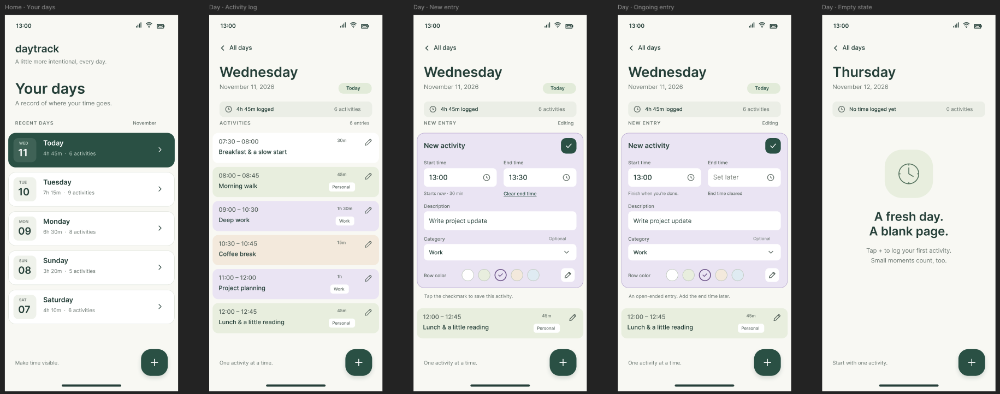

# DayTracker

DayTracker is a productivity mobile app for logging how you spend your time each day. For each entry you record a start time, end time, a description of what you did, and an optional category tag.



## v1 scope

- **Local-only:** All data stays on the device; no accounts or cloud sync
- **Daily time entries:** Create, edit, delete, and browse by day
- **Category tags:** User-managed categories to classify activity type (at most one per entry)

Cloud sync, accounts, reports, live timers, and related features are deferred to later versions.

## Get started

The Expo app lives in `[daytrack/](daytrack/)`.

1. Install dependencies
  ```bash
   cd daytrack
   npm install
  ```
2. Start the app
  ```bash
   npx expo start
  ```

In the output, you'll find options to open the app in a:

- [development build](https://docs.expo.dev/develop/development-builds/introduction/)
- [Android emulator](https://docs.expo.dev/workflow/android-studio-emulator/)
- [iOS simulator](https://docs.expo.dev/workflow/ios-simulator/)
- [Expo Go](https://expo.dev/go), a limited sandbox for trying out app development with Expo

You can start developing by editing the files inside the `daytrack/src/app` directory. This project uses [file-based routing](https://docs.expo.dev/router/introduction).

## Design document

Product requirements, data model, UX outline, and acceptance criteria:

→ [docs/DESIGN.md](docs/DESIGN.md)

## Learn more (Expo)

- [Expo documentation](https://docs.expo.dev/)
- [Learn Expo tutorial](https://docs.expo.dev/tutorial/introduction/)

